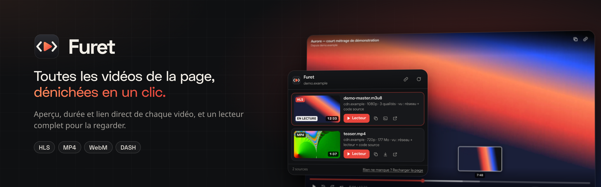
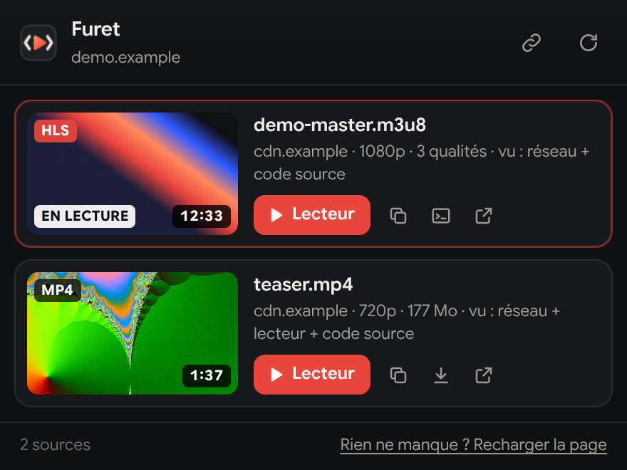
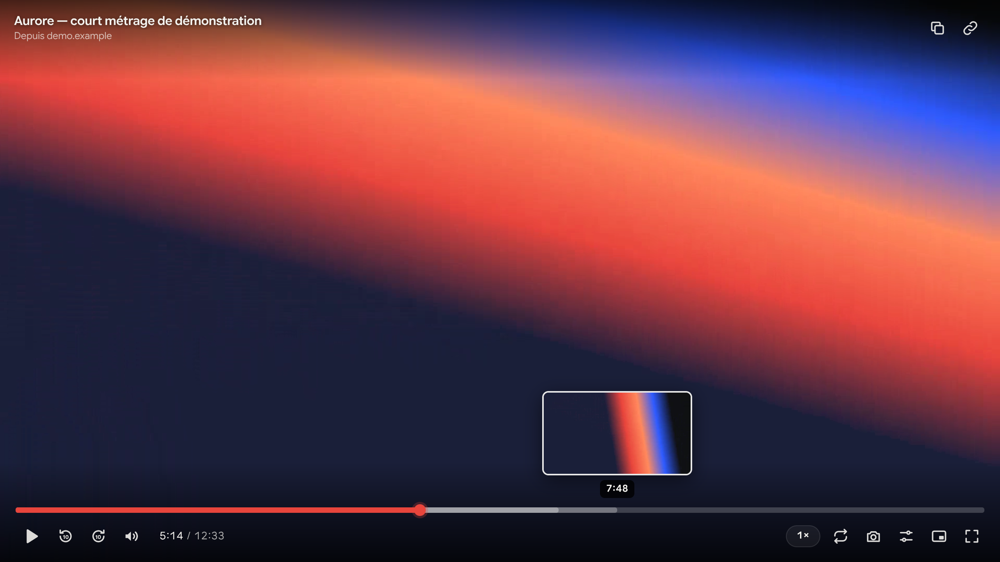
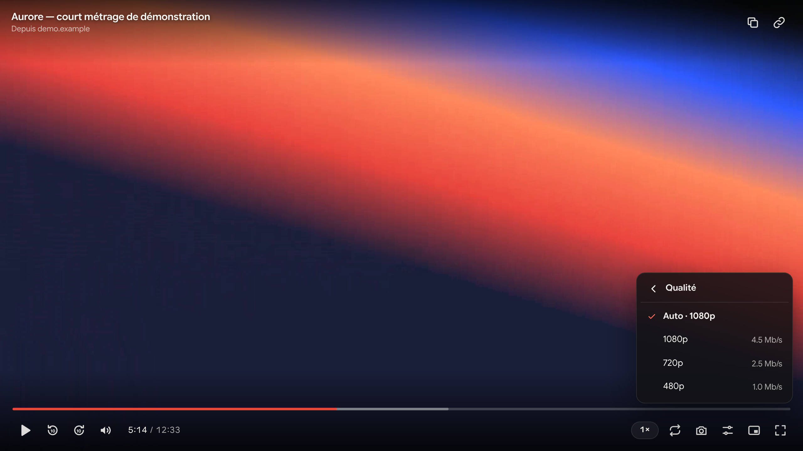

<p align="center"></p>

# Sources vidéo — Chrome extension

🇫🇷 [Version française](README.md)

One click on the toolbar icon lists every video on the current page (thumbnail, duration, quality, size) and lets you:

- **open the video in the extension's own player**;
- copy the direct link;
- download the file (MP4, WebM…);
- copy a ready-to-run `ffmpeg` command for HLS/DASH streams;
- open the raw link in a new tab.

## Screenshots

<p align="center">
  
</p>

<p align="center">
  
</p>

<p align="center">
  
</p>

## Installation

### From the release (easiest)

1. Download `sources-video-vX.Y.Z.zip` from the [releases page](https://github.com/freezer71/extension-sources-video/releases/latest).
2. **Unzip** it into a folder you will keep (Chrome loads the extension from that folder, so don't delete it).
3. Open `chrome://extensions` and turn on **Developer mode** (top right).
4. Click **Load unpacked** and pick the unzipped folder (the one containing `manifest.json`).
5. Pin the icon to the toolbar.

To update: unzip the new version in the same place, then click ⟳ on the extension's card in `chrome://extensions`.

> Chrome cannot install a zip directly: it has to be unzipped. `.crx` files from outside the Chrome Web Store are blocked.

### From source

```bash
git clone https://github.com/freezer71/extension-sources-video.git
```

Then follow steps 3–5 above with the cloned folder.

### Build the zip yourself

```bash
./scripts/package.sh   # → dist/sources-video-v<version>.zip
```

## Usage

1. Open the page and **start the video**: the extension records streams as the site loads them. The red badge shows how many were seen.
2. Click the icon and pick a video. The one currently playing is tagged "EN LECTURE" and listed first.
3. **Lecteur** opens it in a new tab.

If a site cuts playback after a few minutes, the links stay in the list: the block happens after the video has already been requested.
If the video was already playing before the extension was installed, reload the page (button at the bottom of the popup).

## The player

- Seek bar with **frame preview on hover**, click or drag to seek, buffered ranges shown.
- Play/pause, ±10 s, volume (mouse wheel on the icon), elapsed or remaining time (click the time).
- Speed from 0.25× to 3×, **quality** (HLS: Auto or fixed), audio track, stream subtitles or a **.srt/.vtt file** loaded by hand.
- Loop, frame capture (PNG), picture-in-picture, fullscreen, technical info overlay.
- **Resumes** where you left off; volume and speed are remembered.
- Link button (top right): paste any direct video URL.

Keyboard shortcuts (`?` in the player shows them all):

| Key | Action |
| --- | --- |
| `Space` / `K` | Play / pause |
| `←` `→` | −5 s / +5 s (`Shift`: 30 s) |
| `J` `L` | −10 s / +10 s |
| `↑` `↓` | Volume |
| `0`…`9` | Jump to 0 %…90 % |
| `,` `.` | Frame by frame |
| `<` `>` | Speed |
| `F` / double-click | Fullscreen (double-click on the sides: ±10 s) |
| `M` `P` `C` `R` `S` `I` | Mute, PiP, subtitles, loop, capture, info |

## How it works

- `background.js` watches each tab's network responses (`webRequest`) and keeps video streams: HLS (`.m3u8`), DASH (`.mpd`), files (`video/*`, `.mp4`, `.webm`…). Segments (`.ts`, `.m4s`, numbered series such as `seg-1.mp4`, `seg-2.mp4`…) are filtered out.
- The popup also scans `<video>` elements in every frame and links found in the page source. A `blob:` (MediaSource) player is matched to the HLS stream with the same duration.
- HLS manifests are parsed for duration, qualities and DRM. Per-quality playlists are grouped under their master playlist.
- Many video servers require the site's **Referer**. The player and popup add it to their own requests (session `declarativeNetRequest` rules, limited to the extension's requests).
- `lib/hls.min.js` is [hls.js](https://github.com/video-dev/hls.js) 1.5.20 (Apache 2.0, see `lib/hls.LICENSE`), bundled because Manifest V3 forbids remote code.

## Limitations

- **DRM** (Netflix, Disney+, etc.): protected streams are flagged but cannot be played outside the site. The extension does not bypass DRM.
- **DASH**: listed and copyable (`ffmpeg` command), but not played by the player.
- **Signed links**: some expire after a few minutes or are tied to your session. On a 403 error, restart the video on the site and reopen it from the extension.
- YouTube and a few large sites split videos in non-standard chunks: they won't show up as a single source.

## Logo and visuals

| File | Use |
| --- | --- |
| `assets/logo.svg` | Vector logo (48 and 128 px icons) |
| `assets/logo-small.svg` | Simplified variant for small sizes (16 and 32 px) |
| `assets/banner.png` | README banner |
| `assets/social-preview.png` | Repository social preview (1280×640) |
| `assets/store/` | Chrome Web Store visuals: 440×280 tile, 1400×560 marquee, 1280×800 screenshots |
| `assets/screenshots/` | Popup and player screenshots |
| `assets/src/compose.html` | Source of the composed visuals (`?v=banner`, `social`, `promo`, `marquee`, `shot1`, `shot2`) |

Screenshots were taken on a generated demo video (animated gradients), served from the fictional domains `demo.example` and `cdn.example`.
